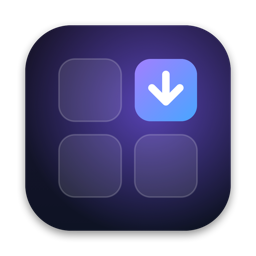
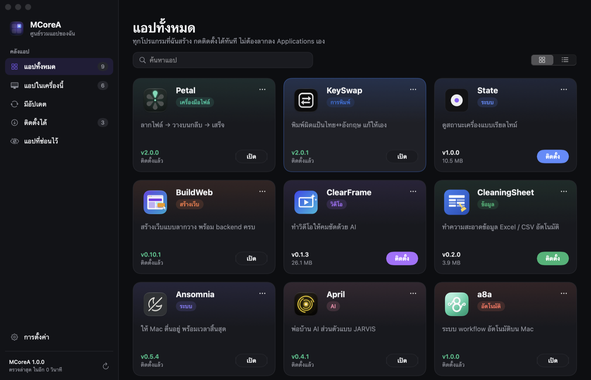
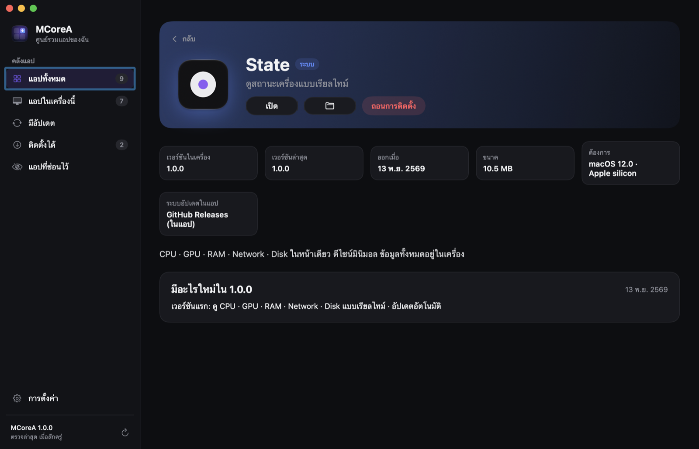
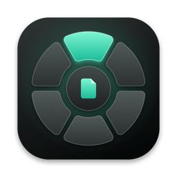
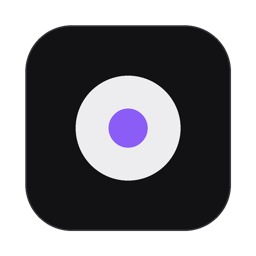
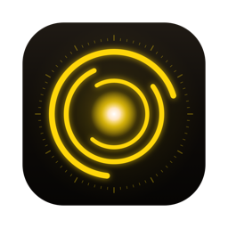
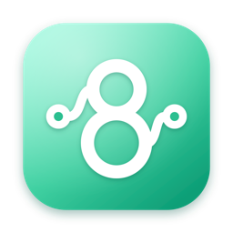

  

<h1 align="center">MCoreA</h1>

  <b>ศูนย์รวมทุกแอปของฉัน กดติดตั้งได้ทันที</b> 
  ไม่ต้องเปิด .dmg ไม่ต้องลากลง Applications เอง · ตรวจและติดตั้งอัปเดตทุกแอปในที่เดียว

  

  ฟรี · macOS 14 ขึ้นไป · Apple silicon และ Intel · อัปเดตตัวเองอัตโนมัติ (Sparkle) ·
  <a href="https://github.com/AImunich20/mcorea-releases/releases">ทุกเวอร์ชัน</a>

## ติดตั้ง
1. ดาวน์โหลด [**MCoreA.dmg**](https://github.com/AImunich20/mcorea-releases/releases/latest/download/MCoreA.dmg) แล้วลาก **MCoreA** ไปไว้ใน **Applications** (ครั้งเดียว)
2. เปิดครั้งแรก: ถ้าขึ้นว่าเปิดไม่ได้ ไปที่ **System Settings → Privacy & Security → Open Anyway**
3. เสร็จแล้ว ต่อจากนี้แอปอื่นทุกตัวกด **ติดตั้ง** ใน MCoreA ได้เลย

## ทำอะไรได้บ้าง
- **ติดตั้งในคลิกเดียว** MCoreA ดาวน์โหลด .dmg จาก GitHub Releases ของแต่ละแอป เปิด แล้วคัดลอกแอปลง Applications ให้เอง (macOS ไม่เตือน "ดาวน์โหลดจากอินเทอร์เน็ต")
- **อัปเดตทุกแอปในที่เดียว** ตรวจอัตโนมัติ (ตั้งได้ 1–24 ชั่วโมง) มีตัวเลขบนไอคอน Dock กด **อัปเดตทั้งหมด** ได้ หรือเปิดให้ติดตั้งเองเบื้องหลัง
- **เลือกเวอร์ชัน** ย้อนไปติดตั้งเวอร์ชันเก่าได้ พร้อมบันทึกการเปลี่ยนแปลงของทุกเวอร์ชัน
- **การ์ดหรือตาราง** · ค้นหา · ซ่อนแอป · ธีมมืด/สว่าง
- **ถอนการติดตั้ง** ย้ายแอปไปถังขยะ

## แอปใน MCoreA

| | แอป | |
|---|---|---|
|  | **Petal** | ลากไฟล์ → วางบนกลีบ → เสร็จ |
|  | **KeySwap** | พิมพ์ผิดแป้นไทย↔อังกฤษ แก้ให้เอง |
|  | **State** | ดูสถานะเครื่องแบบเรียลไทม์ |
|  | **BuildWeb** | สร้างเว็บแบบลากวาง พร้อม backend ครบ |
|  | **ClearFrame** | ทำวิดีโอให้คมชัดด้วย AI |
|  | **CleaningSheet** | ทำความสะอาดข้อมูล Excel / CSV อัตโนมัติ |
|  | **Ansomnia** | ให้ Mac ตื่นอยู่ พร้อมเวลาสิ้นสุด |
|  | **April** | พ่อบ้าน AI ส่วนตัวแบบ JARVIS |
|  | **a8a** | ระบบ workflow อัตโนมัติบน Mac |

## เพิ่มแอปใหม่
แก้ [`catalog.json`](catalog.json) ในรีโปนี้ แล้ว MCoreA ทุกเครื่องจะเห็นแอปใหม่เองโดยไม่ต้องอัปเดตตัว launcher
แต่ละแอปต้องมี GitHub release ที่แนบไฟล์ `.dmg` (ชื่อตาม `assets`) และ repo ต้องเป็น public

## ความเป็นส่วนตัว
MCoreA ติดต่อแค่ GitHub (รายการ release, ไฟล์ดาวน์โหลด, catalog) ไม่มีการเก็บข้อมูลผู้ใช้
GitHub token (ถ้าใส่) เก็บใน Keychain ของเครื่อง

---

## English
**MCoreA** is a launcher for all of my macOS apps. Install any of them in one click (no DMG to open, nothing to drag into Applications), see what's new, pick older versions, and keep every app up to date from one window. MCoreA updates itself with Sparkle from this repo's releases. Download [MCoreA.dmg](https://github.com/AImunich20/mcorea-releases/releases/latest/download/MCoreA.dmg) — macOS 14+, Apple silicon and Intel.
